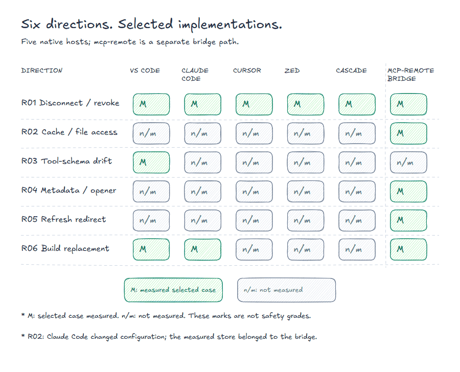

# MCP Host Matrix

**Disconnect is not revoke. Measured across five MCP hosts and one bridge.**

You press "disconnect" in your MCP client. The entry disappears. The access does not. In 12 of 12 measured windows, across five native hosts and the mcp-remote bridge, no revocation request reached the test provider, and the old refresh token still worked. That is one row of this matrix. There are six.

Research by **Alex Gercog** ([playb0t](https://github.com/playb0t)). Evidence snapshot: **25 October 2026**. Builds in the disconnect row: VS Code 1.142.0, Zed 1.24.4, Cascade (Windsurf) 3.10.67, Cursor 3.24.18, Claude Code 2.1.306, mcp-remote 0.15.2; every other row names its own. Every row has a published receipt that carries the SHA-256 of its sources. The repository validates itself in CI. Since 8 November 2026 the method itself is published here: the [portable work method](method/v1/README.md). Run it on your own measurements.

## What the matrix shows

Six directions, each measured on a controlled bench. A local synthetic provider plays both the OAuth authorization server and the MCP resource server, so the record shows what reached it.

- **Disconnect does not revoke. 12 of 12 base windows.** Uninstall, remove or toggle in VS Code, Claude Code, Cursor, Zed and Cascade; configuration removal and session exit on the bridge path. Each window stayed healthy for at least 60 seconds after the action. The provider received no revocation request, and it still accepted the prior refresh token in a separate replay with the client's own credentials. The client knows how to revoke: logout and Clear authentication in Claude Code sent the request, and the provider refused that token. Remove did not send it. ([R01](matrix/MATRIX.en.md#r01))
- **Removing the configuration keeps the credentials.** `claude mcp remove` in Claude Code deleted the entry and left the bridge's cached refresh token on disk, ACL intact. A reader at the known path exchanged it for HTTP 200. Where the drive's permissions were inherited, a reader under a different local account did the same. A private-style ACL stopped it. ([R02](matrix/MATRIX.en.md#r02))
- **Tool schemas change inside a session.** VS Code 1.143.1 refreshed a tool's inputSchema mid-session on a server-sent change notice. Five server-side call validations are recorded. ([R03](matrix/MATRIX.en.md#r03))
- **A server-supplied URL reaches the executable boundary.** The authorization URL taken from server metadata reached the Windows opener path, where an inert recorder stood in for the real handler. An unsupported URI was rejected before it. ([R04](matrix/MATRIX.en.md#r04))
- **A refresh body follows an HTTP 307 to another origin.** The redirect carried the synthetic credential body to a second owned origin. That origin refused the exchange. ([R05](matrix/MATRIX.en.md#r05))
- **Updates keep prior authority. 8 of 8 cells.** After a controlled build replacement the provider kept accepting the authority granted to the previous build. The two native rows reused their prior refresh credentials; the four bridge cells asked for new authorization. ([R06](matrix/MATRIX.en.md#r06))

## What the documentation says

13 hosts and 143 documentation cells on disconnection and stored authority: seven hosts document a disconnect action with no token cleanup, one documents layered actions with gaps, and for five the documentation does not establish the effect at all. Claude Code's documentation says that removing a server "deletes the OAuth tokens and client registration". That describes the local copy; in the measured windows the provider was not told. [Read the table](disconnect/MATRIX.en.md). A second table covers 11 clients and [connecting without a local bridge](hosts/MATRIX.en.md).

## Check your own client

Put these three questions to any MCP client:

1. After disconnect, does a revocation request reach your provider?
2. Does the prior refresh token still exchange?
3. After the server is removed, is the refresh token still on disk, and who can read it?

The passing answer is in R01: a revocation request, then a refused token. [Regression selection](matrix/REGRESSION.md) lists what to recheck when a reachable implementation changes.

## Start here

| Read | Purpose |
|---|---|
| **[R01-R06 evidence matrix](matrix/MATRIX.en.md)** | Scope, subject coverage, observations, controls and limits |
| [Structured matrix](matrix/RESULTS.json) · [evidence fingerprints](matrix/EVIDENCE.json) | Machine-readable outcomes and source SHA-256 values |
| [Deidentified receipts](matrix/receipts/README.md) | Saved observations and controls for every row |
| [Portable work method](method/v1/README.md) | Four work profiles, public receipt links and a verifier, with synthetic examples |
| [Regression selection](matrix/REGRESSION.md) | What to recheck when a reachable implementation changes |
| [Figure index](figures/README.md) | SVG exports, editable sources and verified label mapping |
| [Evidence policy and glossary](docs/EVIDENCE-POLICY.md) | How to read measurements, profiles, controls and source fingerprints |

## What was tested

[](figures/09-coverage/09-coverage.en.svg)

M is a measurement on the bench. "Not measured" is a cell this snapshot leaves open.

<details>
<summary>Coverage as text</summary>

| Direction | Native host subjects | Component subject |
|---|---|---|
| R01 · Disconnect / revoke | VS Code, Claude Code, Cursor, Zed, Cascade | mcp-remote under Claude Code: a separate bridge path |
| R02 · Cache namespace / file access | Not measured | mcp-remote |
| R03 · Tool-schema drift | VS Code | Not measured |
| R04 · Metadata → executable boundary | Not measured | mcp-remote, with an inert recorder |
| R05 · Refresh redirect recipient | Not measured | mcp-remote |
| R06 · Component update / old authority | Claude Code, VS Code | mcp-remote, two launch-selection variants |

</details>

Each row names its own subjects. In R02, Claude Code CLI runs the configuration operation; the measured credential store belongs to the bridge.
## The tracks behind the matrix

| Track | Documentation layer | Runtime layer |
|---|---|---|
| [Connecting without a local bridge](hosts/MATRIX.en.md) | 11 documented clients | [Pinned connectivity bench](hosts/bench/BENCH.en.md): 16 core outcomes plus controls and variants, including Continue's intercepted bridge attempts |
| [Disconnection and stored authority](disconnect/MATRIX.en.md) | 13 hosts, 143 documentation cells | [Lifecycle bench](disconnect/bench/BENCH.en.md): 23 selected runs (12 base windows, 8 operation variants, 3 healthy timing windows) |
| [After a component update](disconnect/bench/BENCH-update.en.md) | Separate from vendor-documentation verdicts | [Eight-cell public results](disconnect/bench/UPDATE-RESULTS.json): four update paths on two provider profiles |

Documentation and runtime measurements are separate evidence layers. Snapshot dates, tested versions, controls and limits are kept in the linked matrix, source metadata and structured results.

## Verify it yourself

Run the repository checks with Python 3.10+:

```console
python -B tools/validate.py
python -B -m unittest discover -s tests -p "test_*.py"
```

The validator checks data coherence, declared file fingerprints, editable-scene JSON, local links and image references, private-data patterns, SVG content and [file checksums](MANIFEST.sha256). One altered byte fails it. It proves the published record; the measurement itself lives in the receipts and controls. Maintainers regenerate the manifest after an intentional edit with `python -B tools/validate.py --write-manifest`.

The repository publishes curated projections and [deidentified receipts](matrix/receipts/README.md). Raw credentials, private profiles, full source artifacts and the bench itself stay with the author. Want your own MCP client measured on this bench? [Open an issue](https://github.com/playb0t/mcp-host-matrix/issues).

New observations enter the matrix through [receipt-bound observations](docs/EVIDENCE-POLICY.md#receipt-bound-observations): a research record declares the cells it covers, its public projection is imported as a matrix receipt with provenance, and the validator refuses a measured cell whose sources are not public artifacts of that receipt. The R01-R06 content stays the original 25 October snapshot, pinned by hash. The importer requires an explicit absolute `--output` outside the source root and creates a complete candidate in that absent directory. It never overwrites the source or reuses an existing output. Success still requires reviewing the candidate and explicitly regenerating and validating its manifest; a failed partial output is retained for inspection. The evidence policy documents snapshot and concurrent-edit limits.

## Limits

The matrix measures selected implementations and operations. Every result holds for the versions, profiles and synthetic fixtures named with it, on owned origins; it is a measurement of those, and the rest of MCP is outside it. R02 ran on a secondary data drive and a synthetic projection of the default-cache ACL, outside real default-profile access. R03 ran a programmatic path, outside ordinary user consent. R04 stopped at an inert recorder, before any real browser or PowerShell. R05 ran between two owned origins, with no exchange at a real provider. R06 used controlled build replacements, not official installers. New CVEs, severity grades, unauthorized actor paths and production impact are outside this matrix; the five mcp-remote records stay in the separate [mcp-remote OAuth security](https://github.com/playb0t/mcp-remote-oauth-security) research, unchanged. SHA-256 fixes the bytes; the receipts and controls carry the measurement.

## Citation

Alex Gercog, *MCP Host Matrix*, version 1.1.0, evidence snapshot 25 October 2026. [CITATION.cff](CITATION.cff) · [Changes](CHANGELOG.md).

Text and data: [CC BY 4.0](LICENSE). Code in `tools/` and `.github/`: [MIT](LICENSE-CODE). Embedded figure fonts retain their [original license](figures/THIRD-PARTY-NOTICES.md).
