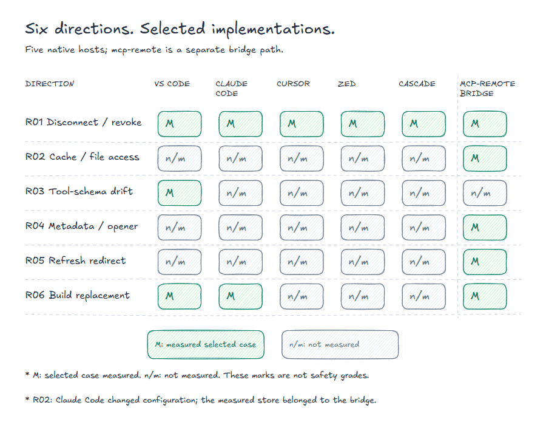

# MCP Host Matrix

**Documented capabilities. Measured host and bridge behavior.**

Research by **Alex Gercog** ([playb0t](https://github.com/playb0t)). Evidence snapshot: **25 October 2026**.

A versioned matrix of selected MCP hosts and the mcp-remote bridge. It compares documentation with measured behavior across six research directions. See the [glossary](docs/EVIDENCE-POLICY.md#glossary) for profile labels and technical abbreviations.

## Start here

| Read | Purpose |
|---|---|
| **[R01-R06 evidence matrix](matrix/MATRIX.en.md)** | Current scope, subject coverage, observations, controls and limits |
| [Structured matrix](matrix/RESULTS.json) · [evidence fingerprints](matrix/EVIDENCE.json) | Curated machine-readable outcomes and source SHA-256 values |
| [Regression selection](matrix/REGRESSION.md) | What to recheck when a reachable implementation changes |
| [Figure index](figures/README.md) | SVG exports, editable sources and verified label mapping |
| [Selected deidentified receipts](matrix/receipts/README.md) | Saved observations and controls for key R01-R06 results |
| [Evidence policy and glossary](docs/EVIDENCE-POLICY.md) | How to read measurements, profiles, controls and source fingerprints |

## What was tested?

This is a study of **selected implementations and operations**, not an audit of the entire MCP protocol or every MCP host.

[](figures/09-coverage/09-coverage.en.svg)

Selected implementations and operations. The marks show measured coverage, not a safety grade or complete MCP coverage.

<details>
<summary>Coverage as text</summary>

| Direction | Native host subjects | Component subject |
|---|---|---|
| R01 · Disconnect / revoke | VS Code, Claude Code, Cursor, Zed, Cascade | mcp-remote under Claude Code: a separate bridge path |
| R02 · Cache namespace / file access | Not measured | mcp-remote |
| R03 · Tool-schema drift | VS Code | Not measured |
| R04 · Metadata → executable boundary | Not measured | mcp-remote, with an inert recorder |
| R05 · Refresh redirect recipient | Not measured | mcp-remote |
| R06 · Component update / old authority | Claude Code, VS Code | mcp-remote, two launch-selection variants |

</details>

A host named in one row was not necessarily tested in the other directions. In R02, Claude Code CLI configuration operations are part of the fixture workflow; the measured credential store belongs to the bridge.

## Selected results

- **Selected disconnect actions did not revoke: 12 of 12 base windows.** Uninstall, remove or toggle for native hosts; configuration removal and session exit for the bridge path. No revocation request reached the provider, and the prior refresh remained usable in a separate controller replay with the client's own credentials. Claude Code logout and Clear authentication provided working revoke/refusal counter-controls.
- **A cache key, a credential recipient and a successful operation differ.** The bridge's same-origin alias route received a bearer from [A](docs/EVIDENCE-POLICY.md#glossary) but returned 401. A separately qualified resource-binding comparison accepted A refresh before rejecting B.
- **Bridge credentials survived configuration removal.** In a separate A-only same-SID test, `claude mcp remove` in Claude Code deleted the configuration entry but retained the bridge cache hash/ACL. A known-path reader exchanged the retained refresh token with HTTP 200.
- **Local permissions matter.** A known-path reader could use a retained bridge refresh under inherited permissions on a secondary data drive; a synthetic private-like DACL projection denied the other SID. Real default-profile runtime access was not tested.
- **Metadata is mutable.** VS Code refreshed a tool's inputSchema inside the same session. Ordinary user-consent behavior was not tested by that programmatic path.
- **The authorization URL reached an executable boundary.** A Windows authorization URL reached an inert recorder; an unsupported URI was rejected before opener entry.
- **An HTTP 307 carried the refresh body to a second origin.** The redirect delivered a synthetic credential body to a second owned origin; that receiver denied exchange.
- **Prior authority survived build replacement: 8 of 8 cells.** The provider continued accepting the prior authority. The two native rows reused prior refresh credentials; four bridge cells requested new authorization. Updates were controlled build replacements, not official installers.

Each statement is scoped to pinned versions, profiles and fixtures. These outcomes do not establish a new CVE, severity, unauthorized actor path, production impact or a universal security grade.

## Existing connection and disconnection tracks

| Track | Documentation layer | Runtime layer |
|---|---|---|
| [Connecting without a local bridge](hosts/MATRIX.en.md) | 11 documented clients | [Pinned connectivity bench](hosts/bench/BENCH.en.md): 16 core outcomes plus controls/variants; includes Continue bridge attempts intercepted before execution |
| [Disconnection and stored authority](disconnect/MATRIX.en.md) | 13 hosts, 143 documentation cells | [Lifecycle bench](disconnect/bench/BENCH.en.md): 12 base + 8 operation variants + 3 healthy timing windows = 23 selected run IDs |
| [After a component update](disconnect/bench/BENCH-update.en.md) | Separate from vendor-documentation verdicts | [Eight-cell public results](disconnect/bench/UPDATE-RESULTS.json): four paths × PUBLIC-NODCR/DCR-ON |

Documentation and runtime measurements are separate evidence layers. Snapshot dates, tested versions, controls and limits are retained in the linked matrix, source metadata and structured results.

## Verification and reuse

Run the repository-only checks with Python 3.10+:

```console
python -B tools/validate.py
```

The validator checks data coherence, declared file fingerprints, editable-scene JSON, local links and image references, common private-data patterns, any SVG content, and [file checksums](MANIFEST.sha256). It does not start MCP clients, fixtures, models or vendor sessions. Maintainers regenerate the manifest after an intentional edit with `python -B tools/validate.py --write-manifest`.

The repository contains curated projections and [selected deidentified receipts](matrix/receipts/README.md), without raw credentials, private profiles or a self-contained experimental harness. Full source artifacts remain author-held. SHA-256 identifies bytes; it does not establish an observation's truth. Additional suitable source material can be requested through the [repository tracker](https://github.com/playb0t/mcp-host-matrix/issues).

## Related research and citation

Package-specific disclosure records are separate: [mcp-remote OAuth security](https://github.com/playb0t/mcp-remote-oauth-security). Host measurements do not create new CVE attribution or change those records.

Alex Gercog, *MCP Host Matrix*, version 1.0.0, evidence snapshot 25 October 2026. [CITATION.cff](CITATION.cff) · [Changes](CHANGELOG.md).

Text and data: [CC BY 4.0](LICENSE). Code in `tools/` and `.github/`: [MIT](LICENSE-CODE). Embedded figure fonts retain their [original license](figures/THIRD-PARTY-NOTICES.md).
