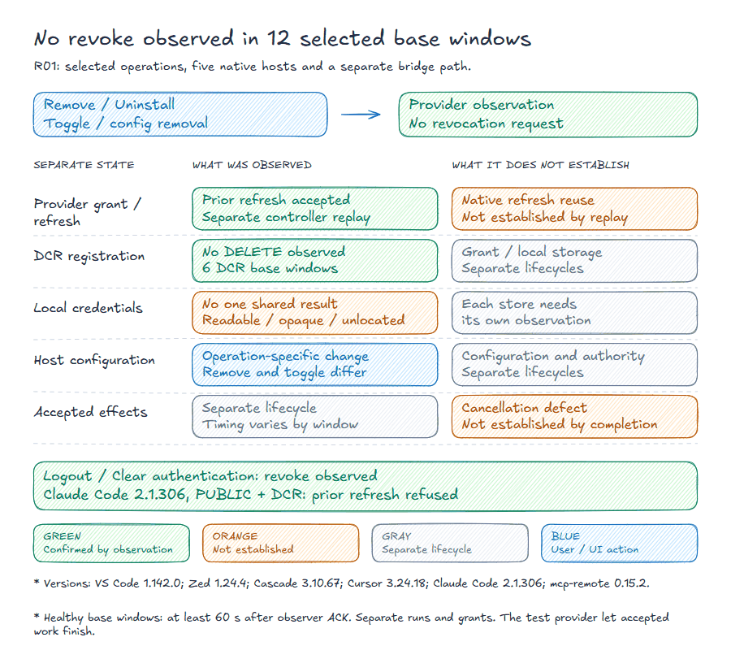

# Remote MCP disconnection and stored authority

[MCP Host Matrix · R01-R06](../matrix/MATRIX.en.md) · [Project](../README.md) · [Glossary](../docs/EVIDENCE-POLICY.md#glossary)

Snapshot and source metadata

Documentation read: 22 October 2026. Measured builds and profiles are listed with each result.

Source notes retain the documentation read date.

Author: Alex Gercog · Repository: [playb0t/mcp-host-matrix](https://github.com/playb0t/mcp-host-matrix) · Related page: [Remote MCP client options without a local bridge](../hosts/MATRIX.en.md).

This page lists what each host documents about disconnecting a remote MCP server; it does not recommend an action or estimate a vendor's cost. Thirteen host rows, eleven fields per row; the host name is the row label. The table covers only the cited official pages and the stated product surface. No clients, accounts or revocation calls were tested for that documentation pass; the separate measured section below records the later bench.

"Not documented" marks a gap in those pages, not proof that an action never happens. Separate logout or whole-app cleanup is recorded without attributing it to Remove. "Layered actions documented" names described cleanup and revocation steps; individual gaps remain visible and no complete retirement is implied.

DCR is dynamic client registration; CIMD is Client ID Metadata Documents (a URL as the client id); both as defined in the [MCP authorization specification, revision 2026-07-28](https://modelcontextprotocol.io/specification/2026-07-28/basic/authorization).

Verdict reads "Disconnect documented; token cleanup not documented" when the pages name a remove or disable action and describe neither local token deletion nor provider-side revocation; "Layered actions documented; gaps remain" when they describe cleanup and revocation steps separately; "Not established by these docs" when no exact disconnect action and effect is given. Cleanup described only as a separate action without a documented link to Remove also leaves the disconnect effect not established; "remove or disable" includes a named Disconnect control.

Every "not documented" verdict is about the inspected pages, not about what the host does.

From the separate runtime bench: twelve selected base windows across five native hosts and one bridge path. Prior refresh was tested in separate controller replays with the profile’s required credentials. Logout/Clear authentication are separate working revocation controls.

| Host | Documentation / sources | Token / registration storage | Disconnect action | Local token deletion | Provider token revocation | Provider client registration | In-flight / background work | Retained data | Lifetime / refresh | User-facing promise | Verdict |
|---|---|---|---|---|---|---|---|---|---|---|---|
| Cursor | Unversioned documentation. The help page mentions Cursor 3.6+ modes, not a document-wide version. [^1] [^2] | Cloud Agents keep their own MCP sign-ins on Cursor servers, separately from machine sign-ins. The local OAuth-token and registration-record location is not given; mcp.json is configuration. | Customize provides a server toggle without removal; Remove appears in the remove-and-readd procedure. Cloud Agents have separate logout on the Cloud row; local sign-out does not sign out Cloud Agents. | Automatic local OAuth-token deletion on toggle, Remove, or sign-out is not described in the inspected pages. | Provider-side token revocation on toggle, Remove, or sign-out is not described; a logout label does not establish that request. | Provider-side DCR-registration deletion or CIMD-identity retirement on disconnection is not described. | A disabled server does not load or appear in chat; treatment of already-running remote calls and background sessions on disconnection is not described. | Deletion of history, results, memory, or OAuth cache after disconnection is not described. npm cache clean in the update procedure is a separate action, not OAuth cleanup. | Expiry, refresh-token renewal, and reauthorization after disconnection are not described; separation of local and Cloud sign-ins is documented. | The promise concerns server availability in chat, not complete retirement of authority. Quote: "Disabled servers won't load or appear in chat". | Disconnect documented; token cleanup not documented |
| Claude Code | No single pinned page-wide version; individual features have version gates. [^3] | OAuth tokens are described as securely stored, without an exact token-store path. Client secrets use the macOS system keychain or a credentials file; that is not a universal token path. Removal explicitly refers to locally stored registration. | `claude mcp remove <name>` removes a remote server and its locally stored OAuth tokens/registration. Disable preserves configuration and stops connecting; Clear authentication and claude mcp logout are separate authentication actions. | Removing a remote server explicitly deletes its saved OAuth tokens and client-registration record. This is not attributed to Disable. Logout separately clears stored credentials. | Clear authentication promises revoke access, and token-revocation requests are documented. Their execution on every remove/Disable is not established by these pages. | Remove deletes the registration Claude Code stored locally; deleting or revoking the DCR client at the provider is not described. | Disable stops connections; remote-disconnection retries are separately described. Cancellation of in-flight remote tool calls on remove/Disable is not established. Stdio shutdown signals are not applied to remote servers. | Disable and Clear authentication explicitly discard the discovery-cache entry. Complete deletion of chats, saved tool results, and other data on remove/disconnection is not described. | Tokens refresh automatically; after a 401, the stored token is refreshed and the request retried once. A rejected refresh token prompts Re-authenticate. | The separate Clear authentication action promises revoke access; that phrase alone does not specify provider-side revocation mechanics. Quote: "revoke access". | Layered actions documented; gaps remain |
| Claude Desktop | Documents do not give a single product version. The row concerns remote custom connectors, not local .mcpb extensions. [^4] [^5] [^6] | Remote connections originate in Anthropic cloud. In the separate Anthropic-held mode, Anthropic holds client credentials; fixed request-header values are stored by Claude. The user OAuth-token and DCR-registration storage backend/path is not specified. | Customize > Connectors (or Organization settings for an Owner) offers Remove and prompts. Help separately describes disconnect and connection settings; authentication settings require remove/re-add, after which members reconnect. | Deleting saved OAuth tokens on Remove/Disconnect is not described. The cloud backend does not establish a local token store or its cleanup. | Provider-side token revocation on Remove/Disconnect, its endpoint, and its result are not described. | Provider-side DCR-client deletion/revocation on disconnect is not described. Documenting a new DCR client on a fresh connection does not document retirement of the old one. | A conversation-level connector toggle is described; completion of in-flight remote calls and background sessions after Remove/Disconnect is not described. | Deletion of history, synced content, tool results, or other retained data after Remove/Disconnect is not described in the inspected pages. | Claude refreshes tokens reactively after a 401 and proactively up to five minutes before stored expiry. Members reconnect after authentication settings are changed through remove/re-add. | When authentication settings change through remove/re-add, members must reconnect; the phrase does not promise complete layered revocation. Quote: "Members then need to reconnect". | Disconnect documented; token cleanup not documented |
| VS Code (GitHub Copilot) | No single pinned document/product version; the Agent Customizations editor is Preview and autostart is experimental. [^7] [^8] | A specific OAuth-token and client-registration store is not described. Sensitive input values are stored for reuse, which does not identify the OAuth store; mcp.json is configuration. | MCP Servers / MCP: List Servers offers Stop Server for the current run, Disable without configuration deletion, and Uninstall. The page advises removing only the source-config entry when Uninstall is unavailable and warns that autodiscovery can restore it. | Automatic deletion of saved OAuth tokens on Stop/Disable/Uninstall or config-entry removal is not described. | Provider-side token revocation on these actions is not described. Trust reset and authentication are explicitly distinguished. | Provider client-registration deletion/revocation on Stop/Disable/Uninstall is not described. | Stop Server ends the current run, but a later request can start it again. Disable prevents startup and removes tools/resources/prompts/apps; exact cancellation of an in-flight remote request is not separately described. | Automatic history/result/cache deletion on disconnection is not described. MCP: Reset Cached Tools separately clears the tool list; Reset Trust addresses a different object. | Initial browser OAuth sign-in is described; refresh, expiry, and reauthorization after Stop/Disable/Uninstall are not described in the inspected pages. | The Stop promise concerns the current run and explicitly permits a later start, not complete retirement of authority. Quote: "End the current run. A later request can start the server again.". | Disconnect documented; token cleanup not documented |
| Windsurf (Cascade) | Unversioned documentation [^9] | OAuth store not documented; mcp_config.json documented as configuration, including explicit headers/env. | Server toggle enables/disables it; no separate revocation effect stated. | Saved OAuth-token deletion on disconnect not documented. | Provider-token revocation on disconnect not documented. | OAuth client-registration revocation/deletion not documented. | In-flight/background handling on MCP removal not documented. | Effect of MCP disconnect on history, memory and response cache not documented. | Remote-MCP refresh/expiry/relogin lifecycle not documented in inspected sections. | Promise is limited to enabling/disabling the server. Quote: "Use the toggle next to a server to enable or disable it.". | Disconnect documented; token cleanup not documented |
| Zed | Unversioned documentation [^10] [^11] [^12] | URL/Authorization config is in settings; OAuth token/registration store not documented. | MCP Servers exposes Uninstall and enable/disable toggle; Uninstall described as removing the server. | Saved OAuth-token deletion on disconnect not documented. | Provider-token revocation on disconnect not documented. | OAuth client-registration revocation/deletion not documented. | MCP-removal effect not documented; a thread stop button is documented separately. | MCP-removal data effect not documented; separate Thread History restores threads. | Remote-MCP refresh/expiry/relogin lifecycle not documented in inspected sections. | Uninstall described as removing the server. Quote: "an `Uninstall` (trash) button to remove it". | Disconnect documented; token cleanup not documented |
| Cline | Unversioned documentation [^13] [^14] [^15] | Bearer headers can be in config JSON (~/.cline/data/settings/cline_mcp_settings.json for CLI); OAuth token/registration store not documented. | CLI wizard supports enable/disable without deletion and Delete server; `cline mcp remove <name>` removes a server. | Saved OAuth-token deletion on disconnect not documented. | Provider-token revocation on disconnect not documented. | OAuth client-registration revocation/deletion not documented. | MCP-removal effect not documented. Separate schedules persist across restarts independently of a terminal; relation to MCP removal unstated. | MCP-removal effect on history/cache not documented; scheduling separately exposes execution history. | Authorize OAuth runs/reruns browser authorization; refresh/expiry not separately documented. | Delete server promises permanent server removal without enumerating OAuth objects. Quote: "Remove a server permanently". | Disconnect documented; token cleanup not documented |
| Goose | Unversioned documentation [^16] [^17] [^18] | Config ~/.config/goose/config.yaml; client_secret_key via env/secret store. General secrets in OS keychain/keyring or secrets.yaml; exact OAuth access/refresh/registration namespace not documented. | Disable extension, then Remove Extension UI/CLI; disabling first required. | A separate full-app cleanup deletes the keyring credential holding all secrets; its OAuth namespace and automatic token deletion on Remove Extension are not documented. | Provider-token revocation on disconnect not documented. | OAuth client-registration revocation/deletion not documented. | In-flight behavior on extension removal not documented; full-app cleanup separately requires stopping CLI/GUI copies. | Extension removal not linked to session data. Sessions autosave on exit; separate Delete Session removes local record. | Remote-MCP refresh/expiry/relogin lifecycle not documented in inspected sections. | Installed extension can be removed after disabling. Quote: "To remove an extension, you must disable it first.". | Not established by these docs |
| Codex CLI | Unversioned pages [^19] [^20] [^21] [^22] | MCP OAuth store modes: auto/file/keyring; a client secret is saved in config.toml. The exact token-file path is not stated. | codex mcp remove deletes the stored server definition; enabled=false disables it without deleting configuration. | A separate codex mcp logout removes stored OAuth credentials. Automatic cleanup on remove/disable is not documented. | Provider-token revocation on remove/disable/MCP logout is not documented. | Provider client-registration deletion or revocation is not documented. | The fate of in-flight MCP calls after remove/disable is not documented. | History/result deletion on MCP removal is not documented; codex delete is a separate saved-session operation. | MCP login is documented; MCP OAuth lifetime, refresh and automatic renewal are not specified. | The remove promise is limited to deleting the server definition. Quote: "Delete a stored MCP server definition.". | Not established by these docs |
| ChatGPT (apps / connectors) | Unversioned Help Center pages [^23] [^24] | The physical OAuth-token and client-registration store is not documented. | Settings > Plugins > account > Disconnect stops future access through that account. Other accounts may remain active. | Stored OAuth-token deletion on Disconnect is not documented. | Future access stops; provider-token revocation requests or RFC 7009 are not documented. | Provider client-registration deletion or revocation is not documented. | The effect of Disconnect on in-flight requests/background tasks is not documented. | Disconnect does not automatically delete conversations, saved files, the Memory summary or other saved memories. Quote: "Disconnecting an app prevents future access but does not delete past conversations that already used app data.". | Reconnect and renewed authorization are documented; token lifetime/refresh policy is not specified. | Promise: stop future access through the selected account. Quote: "Disconnecting stops future access through that account.". | Disconnect documented; token cleanup not documented |
| Continue | Unversioned CLI documentation [^25] [^26] [^27] | The OAuth token/client-registration store is not documented. General environment-variable secrets do not describe an OAuth cache. | /mcp is connection management; an exact disconnect/remove action and effect are not documented. | Local OAuth-token deletion on disconnect is not documented. | Provider-token revocation on disconnect is not documented. | Client-registration deletion or revocation is not documented. | /jobs lists background jobs; the fate of MCP calls/jobs after disconnect is not documented. | /resume restores history; its deletion on MCP disconnect is not documented. | MCP OAuth lifetime/refresh/relogin are not documented; /login and /logout concern the Continue account session. | No exact disconnect promise; /mcp is only Manage MCP server connections. Quote: "Manage MCP server connections". | Not established by these docs |
| Dot (OpenAI) | Live Learn docs, no Dot build stated. Desktop 26.929 is a local-access requirement. [^28] [^29] [^30] [^31] [^32] | Connected app accounts, cloud browser and local-computer grants are separate; OAuth token/client-registration storage is not documented. | Pause, stop delegated task, disable/delete schedule; Uninstall plugin leaves separately connected MCP integrations. Revoke access removes one computer grant; these pages do not name an MCP disconnect control. | Deletion of saved remote-MCP OAuth tokens on disconnect is not documented; a computer-access grant is a different resource. | Provider token revocation on MCP disconnect is not documented; local computer-grant revocation is described separately. | Provider client-registration deletion is not documented. | Pause stops the main task, with delegated tasks and schedules managed separately. An already authorized local task may finish after an admin disables local access. Quote: "an already authorized local task may still be finishing.". | Disconnect stops future access but does not erase retained context; dot context, files, tasks and conversations have separate deletion steps. | Offline preserves the local-access grant; remote-MCP OAuth token expiry or refresh is not documented. | The Disconnected promise is scoped to local computer access, not complete OAuth retirement. Quote: "Disconnected means access has been removed". | Not established by these docs |
| mcp-remote | README main, no release version stated. [^33] | ~/.mcp-auth or MCP_REMOTE_CONFIG_DIR; mcp-remote-v1 layout, the README names old `mcp-remote-0.x.y` directories: Quote: "they hold old tokens and can be deleted.". | README documents rm -rf ~/.mcp-auth as troubleshooting, followed by restart; it does not define a combined disconnect/revoke command. | A separate directory-clear step removes local state and tokens; automatic cleanup when a server definition is removed is not documented. | Provider token revocation on directory cleanup is not documented. | Provider client-registration retirement on local cleanup is not documented. | Settlement of remote in-flight work on disconnect or directory cleanup is not documented. | Saved credentials/debug logs and manual local cleanup are described; remote history/data deletion is not documented. | Device-code refresh tokens are stored for later non-interactive runs; client-credentials tokens are renewed. No fixed token lifetime is promised. | The cleanup promise covers local state and tokens; provider-side grants are not covered. Quote: "clear any locally stored state and tokens.". | Not established by these docs |

Verdict tally, in the order of the definitions above: seven rows "Disconnect documented; token cleanup not documented", one row "Layered actions documented; gaps remain", five rows "Not established by these docs".

## Measured outcomes

The Verdict column above grades what each vendor documents; this section records what a provider received after the documented disconnect action on the bench. A host can read "token cleanup not documented" above and "revocation request: none" here; the first is about pages, the second about one measured window. Here the provider is a local synthetic fixture acting as both the OAuth authorization server and the MCP resource server. Token issuance and revocation belong to its authorization-server role; the slow call and its committed effect belong to its MCP resource-server role.

The fixture used synthetic tokens, an access lifetime of 120 s, refresh tokens always issued, and a 30 s slow tool call. Client builds were pinned. No real provider or model calls and no new vendor login were used; some isolated profiles reused existing dedicated account state, and Cascade used an offline UserStatus response from the earlier connectivity bench described in *Remote MCP client options without a local bridge*. The six paths are the five hosts that connected natively on that bench plus the bridge under Claude Code. The other seven documented hosts were not included in this revocation bench; Continue CLI was tested on the earlier connectivity bench. Each path had the primary profile without DCR shown below and a DCR-ON profile.

The design called for the action about 5 s after the slow call started, before its effect committed. That timing was not met in every window, so in-flight observations remain specific to each window and do not support one uniform in-flight conclusion for the whole set. "The effect" means the slow call's commit at the MCP resource server. UI actions were performed by the author or by scripted pointer input under the author's authorization; CLI and file-edit operations are named separately. Exact click times are not always known. ACK denotes the observer's recorded action evidence, such as persisted configuration, command completion or a revocation request; it is not necessarily a host-native acknowledgement. Each primary window remained open at least 60 s after that ACK.

The controller replayed the same prior refresh token before and after the action with the profile's required client credentials. This controller probe does not describe all client-initiated refresh traffic. "Prior refresh token after" is the outcome of that replay after the action: "token issued" means a new access token was returned; "refused" means the provider answered `invalid_grant`. "Revocation request" means a POST to the authorization server's revocation endpoint, the RFC 7009 operation. The saved fixture implementation declares `revocation_endpoint` in its metadata. The journals record successful authorization-server metadata requests, but do not retain those response bodies; this declaration is established from the implementation, rather than a saved body capture. Endpoint availability alone does not establish an obligation to invoke it on every disconnect action. Here, "none" means no matching request observed within the named healthy window, not over an unlimited period.

| Client | Version | Primary profile | Disconnect action | Revocation request | Prior refresh token after | DCR registration DELETE |
|---|---|---|---|---|---|---|
| VS Code | 1.142.0 | PUBLIC-NODCR | Uninstall | none | token issued | none |
| Zed | 1.24.4 | CONFIDENTIAL-NODCR | Uninstall | none | token issued | none |
| Cascade | 3.10.67 | PUBLIC-NODCR | server Toggle | none | token issued | none |
| Cursor | 3.24.18 | CONFIDENTIAL-NODCR | server Toggle | none | token issued | none |
| Claude Code | 2.1.306 | PUBLIC-NODCR | mcp remove | none | token issued | none |
| Claude Code → mcp-remote | 2.1.306 / 0.15.2 | PUBLIC-NODCR | config removal and session exit | none | token issued | none |

In both tables the DCR registration DELETE column comes from a DCR-ON window; the other columns of the main table use the non-DCR profile in Primary profile. Each main row therefore combines two windows of one client path.

| Action | Client | Revocation request | Prior refresh token after | DCR registration DELETE |
|---|---|---|---|---|
| Disable | VS Code 1.142.0 | none | token issued | none |
| `claude mcp logout` | Claude Code 2.1.306 | sent (access and refresh) | refused | none |
| Clear authentication | Claude Code 2.1.306 | sent (access and refresh) | refused | none |
| server entry removed from mcp.json by file edit | Cursor 3.24.18 | none | token issued | n/a |
| server entry removed from the source config by file edit | VS Code 1.142.0 | none | token issued | n/a |

Disable, logout and Clear authentication each have one selected window per profile; each file-edit variant has one non-DCR window, so its registration DELETE is n/a. Clear authentication used a separate native session on the same profile and grant, so it is not a same-session cancellation test. The VS Code file-edit variant reused a trusted profile; it is not native Uninstall or an independent fresh-profile repetition.

Across five native hosts and one bridge path, none of the 12 base windows produced a revocation request, and the prior refresh remained usable in a separate controller replay. No registration DELETE was observed in the six DCR-ON base windows. Logout and Clear authentication produced revocation requests and subsequent refusal of the prior refresh. The selected set contains 12 base windows, 8 operation variants and 3 additional healthy timing windows: 23 run IDs. Replays used the original profile's required credentials; use by another party was not tested.

Native Cursor Remove was not measured in the pinned build's MCP panel. In the retained VS Code DCR window the effect committed before observer ACK. The test provider let accepted work finish, so completion after transport close alone does not establish a cancellation defect. Store observations were limited: a bridge point control found the refresh token still in its cache; Cascade's exact SQLite entry retained its opaque hash; Claude authentication controls had bounded before/after receipts, while the remove rows had only a later after-read. Zed's credential entry was not located. An unchanged opaque entry does not establish a usable token or access from another profile. Process snapshots around 10 s are bounded observations, not a lifetime or deletion audit. These observations do not assess compliance with a product's stated contract.

The [bench summary](bench/BENCH.en.md) and [public results](bench/RESULTS.json) sit next to this page in the package. The JSON projection lists all 23 run IDs, including the 3 timing windows, outcomes and the SHA-256 of each raw verdict, without tokens or private local paths. A [deidentified R01 receipt](bench/receipts/R01.json) exposes the twelve base windows and working revocation controls. Full per-run originals remain author-held and may be requested through the [repository's issue tracker](https://github.com/playb0t/mcp-host-matrix/issues). The fixture implementation is not bundled; the package supports tracing the outcomes rather than a self-contained rerun.

## Measured outcomes: after a component update

[Eight-cell update data · PUBLIC/DCR](bench/UPDATE-RESULTS.json) · [R06](../matrix/MATRIX.en.md#r06)

The update bench measured whether prior authority survived a controlled build replacement. Four client paths, one version pair each, two profiles per path (PUBLIC-NODCR and DCR-ON): the `mcp-remote` bridge under Claude Code 2.1.306 with an explicit pin 0.1.38 → 0.15.2, the same bridge unpinned with `latest` served by a loopback registry, native Claude Code 2.1.306 → 2.1.310, and native VS Code 1.142.0 → 1.143.1. The provider is the same synthetic loopback fixture as above. Sequence per cell: authorize once on the old version and call a tool; in the native rows, let the access token expire naturally; replace the component; start the new version and let it connect without any manual consent; then replay the prior refresh token from the controller after a 60 s window.

| Path | PUBLIC-NODCR: first connection of the new version | DCR-ON: first connection of the new version | Revocation request at update | Prior refresh token after | DCR registration DELETE |
|---|---|---|---|---|---|
| Bridge, explicit pin 0.1.38 → 0.15.2 | new authorization requested | new registration, new authorization requested | none | token issued | none |
| Bridge, `latest` 0.1.38 → 0.15.2 | new authorization requested | new registration, new authorization requested | none | token issued | none |
| Claude Code 2.1.306 → 2.1.310 | prior refresh token used by the new build, tools completed | old client and refresh token used, tools completed | none | token issued | none |
| VS Code 1.142.0 → 1.143.1 | prior refresh token used by the new build, tools completed | old client and refresh token used, tools completed | none | token issued | none |

In all eight cells the authority issued before the update was still accepted by the provider after it, and no cell carried a revocation request or a registration delete. The two halves differ in what the new version does with that authority. The bridge's new version writes to a new cache namespace, `mcp-remote-v1`, beside the old directory `mcp-remote-0.1.37` (0.1.38 names its cache directory from an internal version string that reads 0.1.37). The old token file keeps identical bytes. The new build does not see the old token and asks for a new authorization; in the DCR profile it registers a separate client before consent, and the old registration stays active. Consent was not given in these cells, so the bridge rows record the request, not a completed new grant. The two native hosts keep the same credentials path and key across the update: the new build reads the prior refresh token, obtains a new access token and completes tool calls without a consent prompt; in the DCR profile the same client continues. Claude Code's credentials file is rewritten in place at the same path; VS Code's secret store keeps the same keys with changed ciphertext, values not decrypted.

Across separate synthetic fixture windows, three Claude Code operations produced distinct provider outcomes. These are different runs and grants, not an uninterrupted history of one grant. `claude mcp remove`: no revocation request, the prior refresh token still issues a token. Update 2.1.306 → 2.1.310: no revocation request, the prior refresh token is used by the new build without a consent prompt. `claude mcp logout` and Clear authentication: revocation requests sent, the prior refresh token refused. The revocation path exists in the client and was observed on logout and Clear authentication only. The documentation sentence for remove, "deletes the OAuth tokens and client registration", describes the local copy; in the measured windows the provider was not told.

The native updates were performed by the author as a same-path replacement of the binary or bundle, not through the official installer or the built-in auto-update; those paths are not measured. The `latest` row used a loopback registry, not the public npm registry. Access-token TTL was 120 s; the observed wait was about 123 s in the final cell, including margin. The short-TTL fixture made expiry observable within minutes; refresh counts are scoped to those windows and their frequency was not diagnosed. Claude Code ran from the CLI with a model-protocol fixture; VS Code ran through a development adapter in a known fixture workspace with workspace trust disabled; no real model, account or browser was used. Each update cell has one completed trial. Severity and contract are not assessed here. The [update bench summary](bench/BENCH-update.en.md) sits next to this page; the [curated eight-cell projection](bench/UPDATE-RESULTS.json) and [deidentified R06 receipt](bench/receipts/R06.json) are bundled. Full source artifacts remain author-held and may be requested through the [repository's issue tracker](https://github.com/playb0t/mcp-host-matrix/issues).

### Cursor

Remove appears in the remove-and-re-add procedure on the [help page](https://cursor.com/help/customization/mcp); the docs page carries the toggle. The docs say "Disabled servers won't load or appear in chat". Cloud Agents keep separate sign-ins; signing out locally does not sign out that cloud connection, and token deletion and provider-side retirement on toggle or Remove are not described. [Documentation](https://cursor.com/docs/mcp).

On the bench (3.24.18, Windows) after the server toggle the provider received no revocation request and the prior refresh token was accepted; the Remove step of the remove-and-re-add procedure was not established in the pinned build's MCP panel (Source Toggle, the mcp.json link, Logout Local and tool settings were present), and removing the entry from mcp.json by file edit gave the same provider result.

### Claude Code

Removing a remote server "deletes the OAuth tokens and client registration" stored for it. Clear authentication, discovery-cache clearing and token-revocation requests are also described; automatic provider revocation on every remove and provider-side registration retirement remain unspecified. [Documentation](https://code.claude.com/docs/en/mcp).

On the bench (2.1.306, Windows) after `claude mcp remove` the provider received no revocation request and the prior refresh token was accepted, with and without DCR; after `claude mcp logout` and Clear authentication the provider received revocation requests for the access and refresh tokens and refused the prior refresh token. Whether `mcp remove` deleted the local token file was not established: the file was read only later after the command; that read found no OAuth entry for the server, which is consistent with deletion but does not prove it without a before-read. After the update 2.1.306 → 2.1.310 (section above) the new build used the stored refresh token in both profiles without a consent prompt, and no revocation request was observed.

### Claude Desktop

For a remote connector the instruction is "Click Remove". The connection runs from Anthropic cloud; these pages do not describe saved user-token deletion or provider-registration retirement on that action. [Documentation](https://claude.com/docs/connectors/custom/add-unlisted).

### VS Code (GitHub Copilot)

Stop Server means "End the current run." A later request may start it again. Disable, Uninstall, trust reset and cached-tool reset are separate controls; token retirement is not described for them. [Documentation](https://code.visualstudio.com/docs/agents/run/manage-mcp-servers). [Configuration](https://code.visualstudio.com/docs/agents/reference/mcp-configuration).

On the bench (1.142.0, Windows) after Uninstall and Disable the provider received no revocation request and the prior refresh token was accepted; the DCR registration stayed in both operation windows.

### Windsurf (Cascade)

Cascade is the agent panel of the Windsurf app; its documentation lives under docs.devin.ai; Devin Local has a separate configuration. The Cascade server toggle can "enable or disable it". The page does not state what that action does to saved OAuth tokens or provider-side tokens and registrations. [Documentation](https://docs.devin.ai/desktop/cascade/mcp).

On the bench (3.10.67, Linux/WSL2) after the server toggle the provider received no revocation request, the prior refresh token was accepted, the slow call completed, and the fixture's exact entry in the local SQLite store retained its opaque hash.

### Zed

The MCP settings include an Uninstall "button to remove it". Thread stop and Thread History are separate controls; the removal description does not cover OAuth token or client-registration retirement. [Documentation](https://zed.dev/docs/ai/agent-settings). [Threads](https://zed.dev/docs/ai/agent-panel).

On the bench (1.24.4, Linux/WSL2) after Uninstall the provider received no revocation request and the prior refresh token was accepted; the credential entry in the local keyring and SQLite files was not located, so local deletion is not established either way.

### Cline

Delete server promises "Remove a server permanently". The docs also distinguish toggling without deletion and rerunning browser authorization. CLI scheduling has its own controls; its work is not documented as stopping on MCP removal. [Documentation](https://docs.cline.bot/mcp/mcp-overview.md). [Scheduling](https://docs.cline.bot/cli/scheduling.md).

### Goose

Before removing an extension, "you must disable it first". Separate full-app cleanup can delete a keyring credential containing all secrets, and session deletion has its own command; neither establishes the OAuth effect of Remove Extension. [Documentation](https://goose-docs.ai/docs/getting-started/using-extensions/). [Cleanup](https://goose-docs.ai/docs/troubleshooting/known-issues/), [Sessions](https://goose-docs.ai/docs/guides/sessions/session-management/).

### Codex CLI

The remove command promises "Delete a stored MCP server definition." A separate MCP logout removes saved OAuth credentials. Provider-token revocation and provider-registration retirement are not specified here. [Documentation](https://learn.chatgpt.com/docs/developer-commands?surface=cli).

### ChatGPT (apps / connectors)

The account-management page says "Disconnecting stops future access through that account." Conversations, files and memories have separate retention controls; these pages do not identify token-revocation requests or client-registration retirement. [Documentation](https://help.openai.com/en/articles/20001494-connecting-and-managing-app-accounts-in-chatgpt). [Retention](https://help.openai.com/en/articles/8809935-deleting-and-archiving-chats-in-chatgpt).

### Continue

The CLI describes /mcp as "Manage MCP server connections". These pages do not define an exact disconnect action or its token, registration and in-flight effects, so this row does not count toward the first verdict ("Disconnect documented; token cleanup not documented"). [Documentation](https://docs.continue.dev/cli/tui-mode).

### Dot (OpenAI)

Dot is a cloud agent with separately granted access to a local computer. For an offline computer, "The saved access grant remains"; Revoke access is a separate action. The docs also separate main tasks, children, schedules and retained data; plugin uninstall leaves separately connected MCP integrations, and these five pages do not name an exact MCP-disconnect procedure. [Documentation](https://learn.chatgpt.com/docs/enterprise/cloud-local-access.md). [Controls](https://learn.chatgpt.com/docs/dots/controls.md), [Plugins](https://learn.chatgpt.com/docs/plugins.md), [Access and data](https://learn.chatgpt.com/docs/enterprise/dots-admin-guide.md).

### mcp-remote

The README documents a separate directory-clear step to "clear any locally stored state and tokens." It does not describe provider-token or provider-client retirement for that step. This documentation row is limited to the README. [Documentation](https://raw.githubusercontent.com/punkpeye/mcp-remote/main/README.md).

On the bench (0.15.2 under Claude Code 2.1.306, Windows) after removing the server entry and a natural session exit the provider received no revocation request and the prior refresh token was accepted; a separate point control found the refresh token still in the bridge's cache file.

## Sources

All documentation sources below were read on **22 October 2026**.

[^1]: [Cursor MCP documentation](https://cursor.com/docs/mcp)
[^2]: [Cursor MCP customization](https://cursor.com/help/customization/mcp)
[^3]: [Claude Code MCP documentation](https://code.claude.com/docs/en/mcp)
[^4]: [Claude custom connectors](https://claude.com/docs/connectors/custom/add-unlisted)
[^5]: [Claude connector management](https://support.claude.com/en/articles/11176164-use-connectors-to-extend-claude-s-capabilities)
[^6]: [Claude connector authentication](https://claude.com/docs/connectors/building/authentication)
[^7]: [VS Code MCP server management](https://code.visualstudio.com/docs/agents/run/manage-mcp-servers)
[^8]: [VS Code MCP configuration](https://code.visualstudio.com/docs/agents/reference/mcp-configuration)
[^9]: [Windsurf Cascade MCP documentation](https://docs.devin.ai/desktop/cascade/mcp)
[^10]: [Zed MCP documentation](https://zed.dev/docs/ai/mcp)
[^11]: [Zed agent settings](https://zed.dev/docs/ai/agent-settings)
[^12]: [Zed agent panel](https://zed.dev/docs/ai/agent-panel)
[^13]: [Cline MCP overview](https://docs.cline.bot/mcp/mcp-overview.md)
[^14]: [Cline documentation index](https://docs.cline.bot/llms.txt)
[^15]: [Cline scheduling](https://docs.cline.bot/cli/scheduling.md)
[^16]: [Goose extensions](https://goose-docs.ai/docs/getting-started/using-extensions/)
[^17]: [Goose troubleshooting and cleanup](https://goose-docs.ai/docs/troubleshooting/known-issues/)
[^18]: [Goose session management](https://goose-docs.ai/docs/guides/sessions/session-management/)
[^19]: [Codex CLI reference](https://developers.openai.com/codex/cli/reference.md)
[^20]: [Codex CLI commands](https://learn.chatgpt.com/docs/developer-commands?surface=cli)
[^21]: [Codex configuration reference](https://developers.openai.com/codex/config-reference.md)
[^22]: [Codex MCP documentation](https://developers.openai.com/codex/mcp.md)
[^23]: [ChatGPT app account management](https://help.openai.com/en/articles/20001494-connecting-and-managing-app-accounts-in-chatgpt)
[^24]: [ChatGPT conversation retention](https://help.openai.com/en/articles/8809935-deleting-and-archiving-chats-in-chatgpt)
[^25]: [Continue CLI configuration](https://docs.continue.dev/cli/configuration)
[^26]: [Continue MCP documentation](https://docs.continue.dev/customize/deep-dives/mcp)
[^27]: [Continue TUI mode](https://docs.continue.dev/cli/tui-mode)
[^28]: [Dot access and data](https://learn.chatgpt.com/docs/enterprise/dots-admin-guide.md)
[^29]: [Dot controls](https://learn.chatgpt.com/docs/dots/controls.md)
[^30]: [Dot local access](https://learn.chatgpt.com/docs/enterprise/cloud-local-access.md)
[^31]: [Dot tasks and memory](https://learn.chatgpt.com/docs/dots/tasks-and-memory.md)
[^32]: [Dot plugins](https://learn.chatgpt.com/docs/plugins.md)
[^33]: [mcp-remote README](https://raw.githubusercontent.com/punkpeye/mcp-remote/main/README.md)

[Records on the `mcp-remote` package, in the advisories repository](https://github.com/playb0t/mcp-remote-oauth-security/tree/main/advisories)
