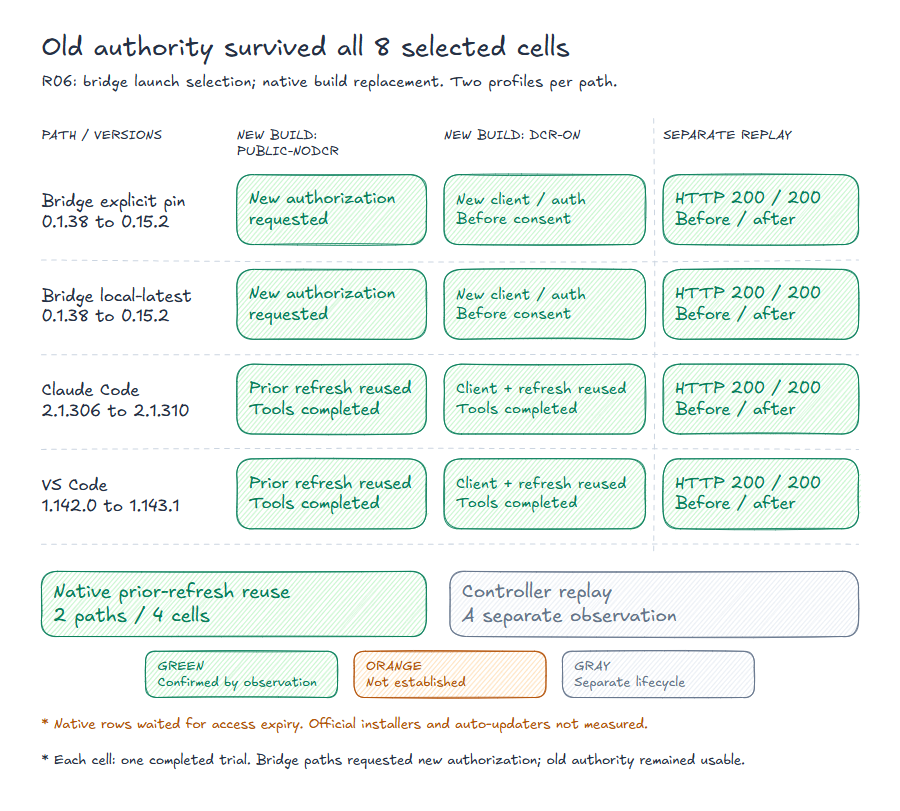

# Measured outcomes: after a component update

[Eight-cell data](UPDATE-RESULTS.json) · [Deidentified R06 receipt](receipts/R06.json) · [Common R06 matrix](../../matrix/MATRIX.en.md#r06) · [Evidence fingerprints](../../matrix/EVIDENCE.json) · [Glossary](../../docs/EVIDENCE-POLICY.md#glossary)

Four paths across PUBLIC-NODCR/DCR-ON give eight selected cells, one completed trial per cell.

Controlled bridge launch selection and native build replacement. Prior authority survived in 8 cells; native prior-refresh reuse occurred in 2 paths / 4 cells. The before/after HTTP replay is a separate observation; official installers and auto-updaters were not measured.

| Path | PUBLIC-NODCR | DCR-ON | Separate prior-refresh controller replay, before / after |
|---|---|---|---|
| Bridge explicit pin, 0.1.38 → 0.15.2 | New authorization requested | New client/authorization, before consent | 200 / 200 in each profile |
| Bridge local latest, 0.1.38 → 0.15.2 | New authorization requested | New client/authorization, before consent | 200 / 200 in each profile |
| Native Claude Code, 2.1.306 → 2.1.310 | Prior refresh reused; native tools completed | Prior client/refresh reused; tools completed | 200 / 200 in each profile |
| Native VS Code, 1.142.0 → 1.143.1 | Prior refresh reused; native tools completed | Prior client/refresh reused; tools completed | 200 / 200 in each profile |

Prior provider authority survived in eight cells/four rows. Surviving authority **and actual prior-refresh reuse by the new build** is supported by two native rows/four cells. Four bridge cells requested new authorization; this did not retire their old grants or cache files. No update-time revocation request was observed; no registration DELETE in DCR-ON cells.

## Versions, policy and store timing

Native binaries/bundles were replaced at the same path/profile after natural access expiry. Bridge rows used explicit-pin or local-latest launch selection without waiting for access expiry. Official installers and live auto-update were not measured. Bridge local-latest used an owned loopback registry.

Access TTL was 120 seconds, refresh TTL 24 hours, rotation disabled. The final native cell waited roughly 123 seconds including margin; this was not the TTL. Clocks/stores were not edited to force expiry. VS Code used a native extension API adapter in a known trust-disabled fixture workspace.

Old bridge files remained byte-identical beside the new namespace. Claude credentials changed in place; VS Code ciphertext changed without decryption. Every after-store snapshot follows at least 60 seconds and a controller replay; immediate first-connection store state was not measured.

## Controls and limits

Each cell has one completed trial; no independent replication is claimed.

Fresh new-build paths and correct before/after replays were qualified. Wrong-client, wrong-management, explicit-revoke and fresh-grant-survival controls apply as recorded. Correct management DELETE followed revoke and does not independently demonstrate retirement of a still-live grant.

Short-TTL VS Code windows contained 4068 native refresh requests in PUBLIC-NODCR and 4312 in DCR-ON, with a separate controller replay each. Their cause is unknown; these are fixture-window counts, not product norms. Counts refer to the closed observation windows and delivered responses.

Official update mechanisms and decrypted SQLite values were not measured. See the [evidence policy](../../docs/EVIDENCE-POLICY.md).
