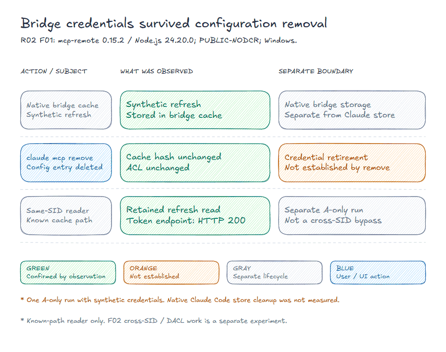
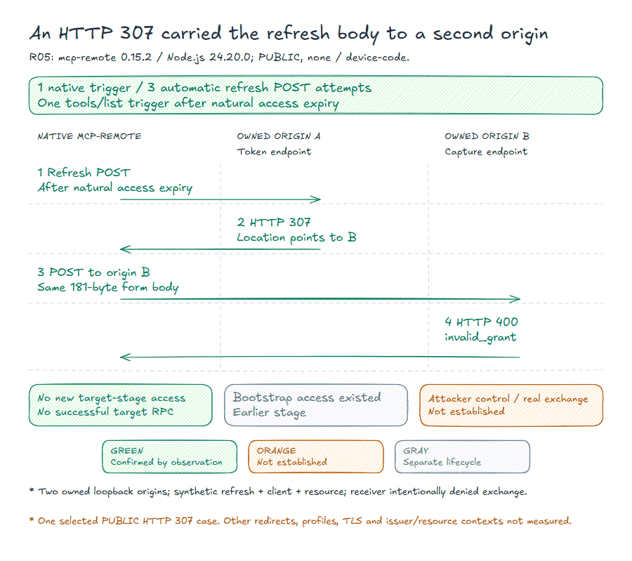

# MCP Host Matrix: selected R01-R06 evidence

[Project](../README.md) · [Structured outcomes](RESULTS.json) · [Source fingerprints](EVIDENCE.json) · [Glossary](../docs/EVIDENCE-POLICY.md#glossary)

Snapshot metadata

Evidence snapshot: 25 October 2026. Tested versions, measurement scopes and source fingerprints are retained in the structured results.

The matrix compares documentation, versioned implementation and measured behavior in controlled fixtures. It covers selected implementations and operations, not all MCP implementations.

## Subject coverage

**M** means a selected case was measured. It is not a pass grade or exhaustive coverage. **Not measured** means this snapshot makes no measurement claim for that subject and direction.

| Direction | VS Code | Claude Code | Cursor | Zed | Cascade | mcp-remote |
|---|---|---|---|---|---|---|
| R01 Disconnect / revoke | M | M | M | M | M | M |
| R02 Cache / file access | Not measured | Not measured | Not measured | Not measured | Not measured | M |
| R03 Schema drift | M | Not measured | Not measured | Not measured | Not measured | Not measured |
| R04 Metadata / opener | Not measured | Not measured | Not measured | Not measured | Not measured | M |
| R05 Refresh redirect | Not measured | Not measured | Not measured | Not measured | Not measured | M |
| R06 Build replacement | M | M | Not measured | Not measured | Not measured | M |

There are five native hosts and one bridge path. In R02, Claude Code CLI performs a configuration operation; the measured credential store belongs to mcp-remote. [Connectivity measurements](../hosts/bench/BENCH.en.md), including Continue's intercepted bridge attempts, form a separate prerequisite track.

## R01: selected disconnect actions did not revoke in 12 of 12 base windows

**Subjects:** VS Code 1.142.0, Zed 1.24.4, Cascade 3.10.67, Cursor 3.24.18, Claude Code 2.1.306 and a separate Claude Code to mcp-remote 0.15.2 path. Windows and Linux/WSL2 results retain their per-path limits.

The selected set contains 12 base windows, 8 operation variants and 3 additional healthy timing windows: 23 run IDs. The documentation population of 13 hosts and 143 cells is a different evidence layer.

No revocation request reached the provider in any base window. The prior refresh token remained usable in a separate controller replay with the profile's required credentials. No registration DELETE was observed in the six DCR-ON base windows. Each base window remained healthy for at least 60 s after observer ACK. That ACK records action evidence, such as persisted configuration, command completion or request receipt; it is not necessarily the exact click time.

**Working controls:** Claude Code logout and Clear authentication sent revocation requests and the provider subsequently refused the prior refresh. Clear authentication used another native session on the same profile and grant.

File edits and native UI operations are identified separately. VS Code's DCR effect committed before observer ACK. The test provider let accepted work finish, so completion after transport close alone does not establish a cancellation defect. Store observations distinguish readable tokens, opaque entries and entries not located; none is substituted for the others.

**Observed traffic:** the complete closed VS Code PUBLIC-NODCR journal, including baseline, contained 3358 token POSTs: 1 native `authorization_code` request, 3355 native refresh requests and 2 controller refresh requests. Of the native refresh requests, 630 began after ACK. The cause of the frequency was not established; these counts are not a product norm.

[Detailed page](../disconnect/MATRIX.en.md) · [Bench](../disconnect/bench/BENCH.en.md) · [23-run results](../disconnect/bench/RESULTS.json). Sources: `r01.report`, `r01.traffic`. [Deidentified receipt](../disconnect/bench/receipts/R01.json).

## R02: bridge credentials survived configuration removal

**Subject:** mcp-remote 0.15.2 / Node.js 24.20.0 on Windows. The five subcases are separate measurements.

| Subcase | Observed result | Scope |
|---|---|---|
| N01 Ordinary different URL | Native A authorization/tools and same-tuple reuse worked. B made five target requests without A Authorization and requested new authorization before consent. | Same Windows account; network receipts, not a file-open audit. |
| N02 Delimiter alias | Different URL/resource tuples serialized to the same input bytes and cache key. B presented A's bearer to another query route on the same origin; response 401, no successful B grant/tool. | Ambiguous serialization, not a cryptographic MD5 collision or an independent external recipient. |
| F01 Same-SID post-remove file | In a separate A-only run, `claude mcp remove` in Claude Code deleted the configuration entry but retained the bridge cache hash/ACL. A same-SID known-path reader exchanged the retained refresh token with HTTP 200. | Separate from F02 and from native Claude Code credential-store cleanup. |
| N03 Resource binding | A refresh returned HTTP 200 before B requested a different explicit resource with the same refresh token and received HTTP 400. No B access token or tool call succeeded. | Qualified positive A control precedes the B-resource comparison. |
| F02 Other SID | Inherited permissions on a secondary data drive allowed known-path read and refresh with HTTP 200. A synthetic projection of the default-cache effective DACL denied read with EPERM; no bytes or HTTP from that reader. | Real default-profile runtime access, native B discovery and file writes were not measured. |

F01: `claude mcp remove` in Claude Code deleted the configuration entry while the bridge cache hash/ACL stayed unchanged. A same-SID known-path reader exchanged the retained refresh with HTTP 200. This is a separate A-only run, not a cross-SID or native Claude credential-store result.

**Controls:** native same-tuple OAuth/tools; A-positive refresh before B; own-readable and private-denied canaries; a separate fresh grant; invalid refresh refusal; A healthy after B; revoked prior refresh refused while the fresh grant remained usable.

F02 has one completed target with two ACL variants. Its closed journal contains 241 events, 46 unique requests and 46 responses. The 2.578 s transaction window is not the 60 s lifecycle-window method.

The denied projection retained **EPERM in the stat/read path; the exact syscall is unknown**. Native file owner, effective DACL and hashes remained unchanged across removal and reader steps. Broad inherited allow permissions do not demonstrate a private-default-profile bypass. Requested POSIX mode alone does not establish a Windows DACL. A later missing file in the alias/resource measurements has no attributed deletion actor.

Sources: `r02.ordinary`, `r02.alias_and_retained_file`, `r02.resource`, `r02.cross_sid`, `r02.syscall_limit`. [Data](RESULTS.json) · [Fingerprints](EVIDENCE.json). [Deidentified receipt](receipts/R02.json).

## R03: inputSchema changed inside one native session

**Subject:** native VS Code 1.143.1, direct STDIO without a bridge. Server/tool names, description, tool set, executable, configuration and connection stayed unchanged. Only `inputSchema` changed from `A{a:string}` to `B{b:string}` with `additionalProperties:false`.

A no-change `list_changed` notification triggered a reread; a separate native inspection still showed A. The changed notification produced B in native metadata. Valid B reached the server and succeeded. Selected invalid B-shaped input before the change and stale A input afterwards also reached the server and were rejected there.

One initialize, two notices and five calls were recorded. **Ordinary UI consent was not measured:** calls used programmatic `invokeTool` with `autoTrustChanges` in a known fixture workspace with trust disabled. Description/tool-set drift, reconnect/restart and poisoning resistance were not measured.

The runtime requested protocol version `2025-11-25`. The report's `2025-06-18` tools contract is a reference, not an exact-version normative audit.

Sources: `r03.report`, `r03.verification`. [Deidentified receipt](receipts/R03.json).

## R04: metadata URL reached an executable boundary

**Subject:** mcp-remote 0.15.2 / Node.js 24.20.0, Windows STATIC PUBLIC authorization-code flow. An instrumented child environment selected an inert recorder executable. Package and built-in functions were unchanged; real PowerShell, browser and URI-handler interpretation was not executed.

Standalone stock-opener controls matched exact URL, arguments, executable image, process identity and exit, and rejected a different captured target.

| Case | Observed boundary |
|---|---|
| HTTP authorization endpoint | Constructed OAuth URL to Base64 UTF-16LE arguments to an actual inert-recorder event, with retained image/creation/parent and natural recorder exit 0 |
| Unsupported `r04-fixture` URI | Explicit `sanitizeUrl` error and module/provider stack before opener entry; no recorder event; native exit 1 |

Opener success was logged at **06:42:28.757 UTC** while the helper was running. Its exit 0 was logged at **06:42:28.884 UTC**. The success log therefore did not wait for helper exit.

Discovery, URL logging and a callback listener existed before rejection. Cached-DCR preflight also precedes the sanitizer in source, but these STATIC PUBLIC cases did not use it.

Each case has 7 requests, 7 responses and 14 provider events; no authorization codes or tokens were issued. Five retained target identities were inactive and four exact ports had no listener. The positive recorder exited naturally; the waiting Node/wrapper was stopped after observation with exit 97. The negative Node/wrapper exited naturally with 1.

Metadata bodies were not separately captured. Request/response records, fixture state/source and the resulting URL were retained. Other URI/platform/authentication contexts and real interpreter/handler effects remain unmeasured.

Sources: `r04.report`, `r04.verification`, `r04.timing`. [Deidentified receipt](receipts/R04.json).

## R05: an HTTP 307 carried the refresh body to a second origin

**Subject:** mcp-remote 0.15.2 / Node.js 24.20.0; PUBLIC client with authentication method `none`, device-code flow and native STDIO to HTTP. Control and target used separate synthetic grants, two owned loopback origins, access-token TTL 120 s and nonrotating refresh tokens.

After natural expiry, **one `tools/list` trigger produced three automatic refresh POSTs**. Origin A returned HTTP 307 to B's capture endpoint. B received the same synthetic refresh/client/resource form body in all three attempts: 181 bytes, SHA-256

`0cf3a5678828d896f9891afc4abef467b683fa033acb507343ecec6a4078df10`.

The three attempts spanned 32 ms. This is one trigger with automatic attempts, not three replications or a general latency result.

B returned HTTP 400 `invalid_grant`. **No new access token was issued during the target refresh stage; bootstrap access had existed earlier.** No target RPC succeeded. Grant lineage is established by A's state/binding checks, not a `grant_id` field received by B. Further device authorization was not approved.

Two owned loopback origins and synthetic credentials. One trigger led to three automatic attempts; B captured the same 181-byte body and deliberately denied exchange. Bootstrap access existed earlier. Attacker control of a trusted server’s Location and successful real-provider exchange were not established.

**Controls:** valid direct native refresh with HTTP 200 and a new-bearer MCP call; invalid refresh refusal; A/B health; dummy exact-body/process capture. Body, process and directed-TCP records establish delivery. An absent Authorization header does not remove the credential carried in the form body.

The receiver deliberately denied exchange. Attacker control of Location without control of the trusted authorization server, successful exchange at a real provider and other redirect/authentication/TLS/issuer/resource combinations were not established.

Sources: `r05.verdict`, `r05.verification`, `r05.qualifications`. [Deidentified receipt](receipts/R05.json).

## R06: prior authority survived build replacement in 8 of 8 cells

Four paths across PUBLIC-NODCR and DCR-ON give eight selected cells. Each cell has one completed trial; no independent replication is claimed.

| Path / versions | New-build PUBLIC-NODCR | New-build DCR-ON | Separate controller replay, before / after |
|---|---|---|---|
| Bridge explicit pin 0.1.38 to 0.15.2 | New authorization requested | New client/authorization, before consent | 200 / 200 in each profile |
| Bridge local-latest 0.1.38 to 0.15.2 | New authorization requested | New client/authorization, before consent | 200 / 200 in each profile |
| Claude Code 2.1.306 to 2.1.310 | Prior refresh reused; native tools completed | Prior client/refresh reused; tools completed | 200 / 200 in each profile |
| VS Code 1.142.0 to 1.143.1 | Prior refresh reused; native tools completed | Prior client/refresh reused; tools completed | 200 / 200 in each profile |

Prior provider authority remained usable across all four paths and eight cells. **Actual prior-refresh reuse by the new build** was observed in the two native paths/four cells. The four bridge cells requested new authorization. No update-time revocation request or DCR registration DELETE was observed.

Native binaries/bundles were replaced at the same path/profile after natural access expiry. Bridge rows used explicit-pin or local-latest launch selection without waiting for access expiry. **Official installers and built-in auto-updaters were not measured.** Access-token TTL was 120 s, refresh-token TTL 24 h and rotation was disabled. The local-latest path used an owned loopback registry.

Old bridge files remained beside the new namespace. Claude credentials changed in place; VS Code ciphertext changed without decryption. All after-store snapshots followed at least 60 s of observation and a controller replay, so immediate first-connection store state was not measured.

The closed short-TTL VS Code windows contained 4068 native refresh requests in PUBLIC-NODCR and 4312 in DCR-ON, with one separate controller replay each. Their frequency was not diagnosed and is not a product norm. Wrong-client/management and revocation/fresh-grant controls are recorded where applicable. Correct management DELETE followed revocation and does not independently establish retirement of a still-live grant.

[Eight-cell results](../disconnect/bench/UPDATE-RESULTS.json) · [Update summary](../disconnect/bench/BENCH-update.en.md). Sources: `r06.synthesis`, `r06.public` and the eight raw-verdict fingerprints. [Deidentified receipt](../disconnect/bench/receipts/R06.json).

## Using the matrix

Configuration removal, token/grant retirement, registration deletion, local store, metadata, transport and accepted effects are distinct states. These results identify which transitions occurred in each selected operation.

A new version does not erase earlier evidence. Compare its reachable implementation change with the relevant case, controls and limits. The [regression selection map](REGRESSION.md) identifies bounded follow-ups; it does not claim those follow-ups have run.

[Evidence policy](../docs/EVIDENCE-POLICY.md) · [Structured results](RESULTS.json) · [Source fingerprints](EVIDENCE.json).
